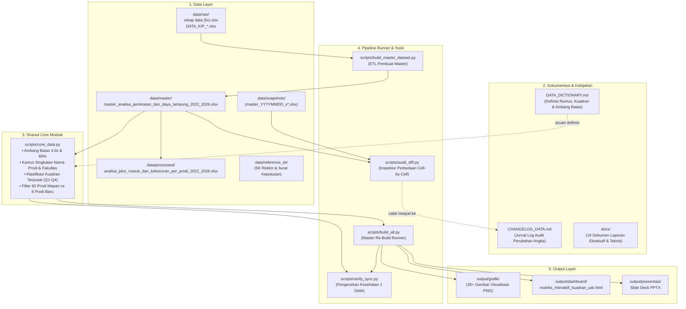

# 🏛️ Panduan Arsitektur & Alur Kerja Sinkronisasi Repositori
**Sistem Pipeline Otomatis, Audit Trail, dan Pencegahan Kerja Ganda pada Analisis Data USK**

---

## 1. Pendahuluan: Mengapa Sistem Ini Dibangun?

Pada tahap awal proyek, seringkali terjadi masalah klasik dalam pengelolaan data dan visualisasi:
1. **Kerja Dua Kali (*Duplicate Work*):** Ketika angka di database Excel diperbarui (misalnya kuota Teknik Perminyakan atau revisi Teknik Lingkungan), grafik PNG dan dashboard HTML tidak otomatis terbarui.
2. **Angka Statis Tercecer (*Hardcoded Values*):** Jumlah prodi di pojok kuadran (misal: "28 Prodi") sempat ditulis secara statis di beberapa script terpisah, sehingga ketika data berubah, teks grafik tertinggal.
3. **Ketidakpastian Sinkronisasi (*Lack of Verification*):** Anda harus membuka dan memeriksa manual gambar satu per satu untuk memastikan apakah grafik sudah memakai database terbaru.
4. **Kehilangan Jejak Riwayat (*Untracked Excel Changes*):** File Excel adalah berkas biner yang tidak bisa dibaca perubahannya secara baris-per-baris melalui Git biasa.

Untuk menyelesaikan masalah ini secara permanen, repositori ini telah distandardisasi dengan **Arsitektur Pipeline Terpadu Modular (*Single Source of Truth & One-Click Build*)**.

---

## 2. Diagram Arsitektur Repositori



---

## 3. Komponen Utama & Peranannya

### A. Modul Sentral: `scripts/core_data.py`
- **Lokasi:** `scripts/core_data.py`
- **Peran:** Menjadi satu-satunya tempat definisi ambang batas kuadran (`4.0x` dan `80%`), kamus singkatan nama prodi, singkatan fakultas, serta fungsi pembaca data master `load_s1_master()`.
- **Manfaat:** Jika ambang batas atau nama prodi diubah di masa depan, **cukup ubah di file ini saja**, seluruh grafik dan dashboard otomatis mengikuti secara terpadu.

### B. Pipeline Runner: `scripts/build_all.py`
- **Lokasi:** `scripts/build_all.py`
- **Peran:** Perintah *One-Click* untuk memperbarui seluruh visualisasi.
- **Urutan Kerja:**
  1. Memvalidasi database master.
  2. Men-generate seluruh Chart reguler (1–17).
  3. Men-generate Chart 13 All Labels (66 prodi).
  4. Men-generate Chart 13 Tanpa Prodi Baru (60 prodi mapan).
  5. Men-generate Slide 2 Direktori Roster Kuadran.
  6. Men-generate Dashboard Interaktif HTML.
  7. Menjalankan audit verifikasi akhir secara otomatis.

### C. Fast Health Checker: `scripts/verify_sync.py`
- **Lokasi:** `scripts/verify_sync.py`
- **Peran:** Menjawab pertanyaan *"Apakah file gambar/HTML saya sudah sesuai database terbaru?"* dalam **kurang dari 1 detik**.
- Membandingkan *timestamp* waktu modifikasi file Excel master terhadap seluruh artefak output. Jika ada file output yang lebih tua dari Excel master, terminal akan memberi sinyal peringatan ❌.

### D. Inspektur Perbedaan Cell: `scripts/audit_diff.py`
- **Lokasi:** `scripts/audit_diff.py`
- **Peran:** Membandingkan file Excel saat ini dengan file backup/snapshot secara *cell-by-cell*.
- Menampilkan dengan presisi baris prodi mana yang berubah, kolom apa yang diedit, dan nilai lama vs nilai baru.

### E. Penyimpanan Versi: `data/snapshots/`
- Folder penyimpanan salinan master Excel bertanggal (misal `master_20261009_v2_revisi_perminyakan_lingkungan.xlsx`).
- Menjadi jaminan keamanan agar Anda bisa kembali ke versi lama kapan saja (*rollback*).

---

## 4. SOP Alur Kerja (Workflow) Jika Ingin Mengubah Data atau Kode

Ikuti 5 langkah mudah berikut setiap kali Anda (atau AI) ingin mengubah data atau formula:

```
[Langkah 1] Buat Snapshot Backup
    └─ Salin master Excel saat ini ke folder data/snapshots/ dengan nama bertanggal.

[Langkah 2] Terapkan Perubahan Data / Kode
    └─ Ubah file master Excel atau parameter di scripts/core_data.py.

[Langkah 3] Cek Perbedaan Nilai
    └─ Jalankan: python3 scripts/audit_diff.py
    └─ Pastikan hanya cell yang memang ingin Anda ubah yang terdeteksi.

[Langkah 4] Sinkronkan Semua File Sekaligus
    └─ Jalankan: python3 scripts/build_all.py
    └─ Semua grafik PNG dan HTML interaktif otomatis di-render ulang secara berurutan.

[Langkah 5] Catat di Jurnal Log
    └─ Tambahkan 1 ringkasan paragraf perubahan di CHANGELOG_DATA.md.
```

---

## 5. Skenario Khusus: Jika Anda & Rekan Mengubah Data Mentah (`data/raw/rekap data (fix).xlsx`)

Dalam kerja tim sehari-hari, Anda dan rekan mungkin sering menerima data pembaruan atau revisi di file Excel masukan mentah: `data/raw/rekap data (fix).xlsx`.

Bagaimana agar perubahan di `data/raw/rekap data (fix).xlsx` otomatis mengalir ke `data/master/master_analisa_peminatan_dan_daya_tampung_2022_2026.xlsx` dan seluruh visualisasi?

### Alur Otomatisasi Terintegrasi:
```
data/raw/rekap data (fix).xlsx       <-- Anda & Rekan mengedit file ini
           │
           ▼  CUKUP JALANKAN 1 PERINTAH:
   python3 scripts/build_all.py
           │
           ├─ 1. Otomatis Deteksi: Mendeteksi bahwa file raw lebih baru dari master
           ├─ 2. Auto-Snapshot   : Membuat backup master lama ke data/snapshots/
           ├─ 3. ETL Master      : Menjalankan build_master_dataset.py (hitung OLS slope, CAGR, kuadran)
           ├─ 4. Visualisasi     : Render ulang grafik PNG (1-17, All Labels, 60 Prodi, Direktori)
           ├─ 5. Rekap Selisih   : Generate rekap_selisih_lulus_vs_daftar_ulang_2022_2026.xlsx
           │                       (KPI Card, Tren Tahunan, Fakultas berbasis Formula Live Dinamis)
           ├─ 6. Dashboard Web   : Kompilasi matriks_interaktif_kuadran_usk.html
           └─ 7. Verifikasi      : scripts/verify_sync.py (Audit 1 detik: 100% SYNCED)
```

### Cara Eksekusi:
1. **Cara Otomatis (Rekomendasi):**
   Cukup jalankan:
   ```bash
   python3 scripts/build_all.py
   ```
   Pipeline akan mendeteksi perbedaan *timestamp* secara otomatis dan melakukan *full refresh* dari data mentah hingga seluruh visualisasi dan Excel olahan.

2. **Cara Eksplisit / Paksa (*Force Refresh*):**
   Jika ingin memastikan Master Excel dibangun ulang dari awal dari data mentah:
   ```bash
   python3 scripts/build_all.py --from-raw
   ```

3. **Cara Manual Bertahap (Jika Hanya Ingin Update Master Tanpa Grafik):**
   ```bash
   python3 scripts/build_master_dataset.py
   python3 scripts/verify_sync.py
   ```

---

## 6. Cara Melakukan *Rollback* (Kembali ke Versi Lama)

Jika suatu saat Anda merasa data baru keliru atau ingin mengembalikan hasil analisis ke kondisi sebelumnya:
1. Buka folder `data/snapshots/`.
2. Pilih file snapshot yang diinginkan (misal `master_20261009_v2_revisi_perminyakan_lingkungan.xlsx`).
3. Salin dan timpa file tersebut menjadi file master aktif:
   ```bash
   cp data/snapshots/master_20261009_v2_revisi_perminyakan_lingkungan.xlsx \
      data/master/master_analisa_peminatan_dan_daya_tampung_2022_2026.xlsx
   ```
4. Jalankan sinkronisasi ulang:
   ```bash
   python3 scripts/build_all.py
   ```
5. Dalam waktu ~17 detik, seluruh grafik, visualisasi, dan HTML akan seketika kembali ke kondisi versi lama tersebut secara utuh dan konsisten.

---

## 7. Daftar Perintah Siap Pakai (*Command Cheat Sheet*)

| Kebutuhan Anda | Perintah Terminal | Waktu Eksekusi |
| :--- | :--- | :---: |
| **Cek status sinkronisasi repo** | `python3 scripts/verify_sync.py` | ~1 detik |
| **Bandingkan perubahan sel Excel** | `python3 scripts/audit_diff.py` | ~2 detik |
| **Update SEMUA (Auto-detect Raw Data)** | `python3 scripts/build_all.py` | ~17 detik |
| **Paksa Rebuild dari Raw Data** | `python3 scripts/build_all.py --from-raw` | ~22 detik |
| **Hanya update grafik PNG** | `python3 scripts/build_all.py --charts-only` | ~15 detik |
| **Hanya update HTML interaktif** | `python3 scripts/build_all.py --html-only` | ~1 detik |

---

## 8. Rujukan Dokumen Terkait
- [README.md](file:///Users/auliamuzhaffar/Documents/maganghub/tugas-5/README.md) : Panduan utama struktur direktori dan ringkasan eksekutif repositori.
- [CHANGELOG_DATA.md](file:///Users/auliamuzhaffar/Documents/maganghub/tugas-5/CHANGELOG_DATA.md) : Catatan kronologis setiap perubahan angka historis.
- [DATA_DICTIONARY.md](file:///Users/auliamuzhaffar/Documents/maganghub/tugas-5/DATA_DICTIONARY.md) : Definisi rumus, aturan prodi baru, dan strategi 4 kuadran.
- [docs/](file:///Users/auliamuzhaffar/Documents/maganghub/tugas-5/docs) : Direktori lengkap 19 dokumen analisis mendalam.
