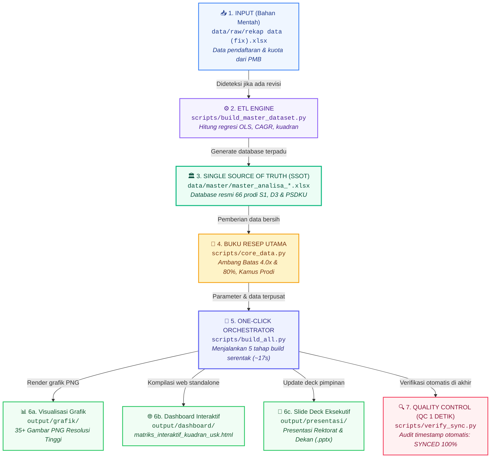
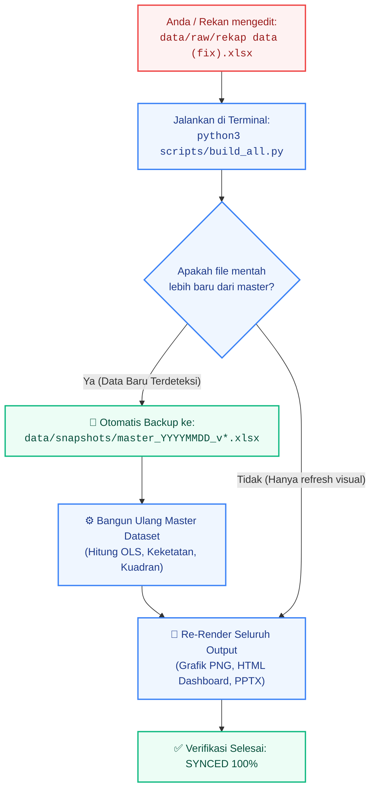

# 📊 Diagram Visual Alur Pipeline & Arsitektur Repositori
**Sistem Otomasi Data, Single Source of Truth (SSOT), dan One-Click Build USK**

Dokumen ini menyajikan representasi visual diagram alur kerja (*pipeline workflow*) dari hulu (data mentah) hingga hilir (grafik, dashboard, dan presentasi) agar mudah dilihat dan dipelajari melalui Markdown Preview.

---

## 1. Diagram Alur Utama (End-to-End Pipeline)



---

## 2. Penjelasan 7 Tahapan Alur Kerja

| No | Tahapan | Berkas Terkait | Fungsi & Tanggung Jawab |
| :---: | :--- | :--- | :--- |
| **1** | **Input Data Mentah** | [`data/raw/rekap data (fix).xlsx`](file:///Users/auliamuzhaffar/Documents/maganghub/tugas-5/data/raw/rekap%20data%20%28fix%29.xlsx) | File masukan mentah dari tim PMB atau rekan kerja yang memuat data kuota, pendaftar, dan kelulusan tahunan. |
| **2** | **ETL Engine** | [`scripts/build_master_dataset.py`](file:///Users/auliamuzhaffar/Documents/maganghub/tugas-5/scripts/build_master_dataset.py) | Mengolah data mentah menjadi data saintifik: menghitung slope tren (OLS), CAGR 5 tahun, persentase keterisian, dan klasifikasi kuadran. |
| **3** | **Single Source of Truth** | [`data/master/master_analisa_peminatan_dan_daya_tampung_2022_2026.xlsx`](file:///Users/auliamuzhaffar/Documents/maganghub/tugas-5/data/master/master_analisa_peminatan_dan_daya_tampung_2022_2026.xlsx) | **Satu-satunya sumber data sah**. Seluruh grafik dan dokumen mengacu ke file ini agar tidak ada angka yang berbeda di tempat lain. |
| **4** | **Buku Resep Utama** | [`scripts/core_data.py`](file:///Users/auliamuzhaffar/Documents/maganghub/tugas-5/scripts/core_data.py) | Modul Python yang menyimpan aturan bisnis (keketatan $\ge 4.0\text{x}$, keterisian $\ge 80\%$, daftar prodi baru, dan pemetaan nama prodi). |
| **5** | **One-Click Orchestrator** | [`scripts/build_all.py`](file:///Users/auliamuzhaffar/Documents/maganghub/tugas-5/scripts/build_all.py) | Perintah komando utama. Cukup jalankan satu baris ini, seluruh proses build berjalan otomatis secara berurutan. |
| **6** | **Output Siap Pakai** | `output/grafik/`, `output/dashboard/`, `output/presentasi/` | Hasil akhir visual yang siap dipresentasikan ke Rektor, Wakil Rektor, atau Dekanat dalam rapat pimpinan. |
| **7** | **Quality Control** | [`scripts/verify_sync.py`](file:///Users/auliamuzhaffar/Documents/maganghub/tugas-5/scripts/verify_sync.py) | Pemeriksaan instan (kurang dari 1 detik) untuk memastikan semua file output sudah memakai data master terbaru. |

---

## 3. Diagram Deteksi Otomatis & Pembuatan Snapshot Cadangan

Jika Anda atau rekan mengubah data di file mentah, berikut alur otomatisasi pengamanannya:



---

## 4. Perintah Cepat untuk Keseharian

```bash
# 1. Cek apakah grafik Anda sudah tersinkron dengan database terbaru (1 detik)
python3 scripts/verify_sync.py

# 2. Cek baris atau sel Excel mana yang baru saja berubah (2 detik)
python3 scripts/audit_diff.py

# 3. Sinkronkan seluruh grafik PNG, dashboard HTML, dan PPT sekaligus (17 detik)
python3 scripts/build_all.py
```
